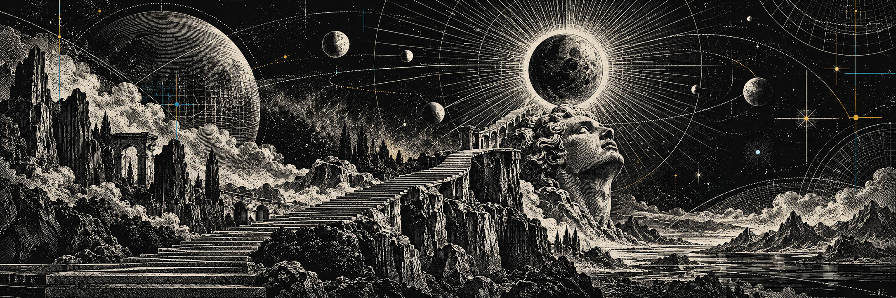

I’m a Product Designer building with AI and exploring how agents, tools and automation can work together to solve practical problems.

I bring a product perspective: understanding the problem, shaping how the solution should work, and building something people can actually use.

Through hands-on projects, I’m developing my skills in agentic development and AI integration — connecting models, tools and workflows into useful products.

[Portfolio & contact → szarkabalint.hu](https://www.szarkabalint.hu)

## Selected project

### [Helyi leirat](https://github.com/szarkab/helyi-leirat)

A free macOS app for transcribing Hungarian audio locally on Apple Silicon. Built with Whisper large-v3 and MLX, with timestamped TXT/Markdown exports and optional automatic speaker separation.

[Explore the project →](https://github.com/szarkab/helyi-leirat)
